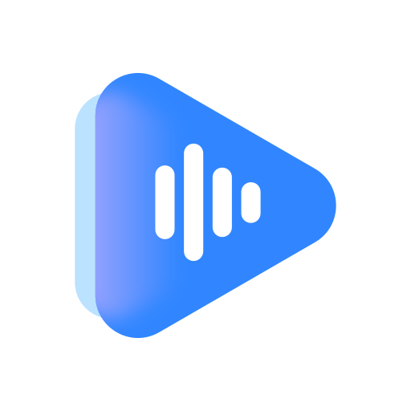

# BoomingFlow

### Your local library, your Spotify, one player.

**BoomingFlow** is a local-first music player for Android with a **Spotify discovery front end** and a **YouTube Music streaming back end**. Browse your own library and your Spotify account side by side, stream anything you don't have, and download what you want to keep — all in one app.

## Features

**Local library**
- Albums, artists, genres, folders and playlists with a fully customizable home
- Tag editor, folder support, blacklists/whitelists, smart sorting
- Gapless playback, ReplayGain, equalizer, sleep timer, Android widgets

**Spotify integration (Discover)**
- Your personalized Spotify home feed, public playlists and Liked Songs
- Spotify search (tracks + public playlists) with endless scrolling
- Every remote track is matched on YouTube Music and streamed through Media3
- Playlists are cached, so downloaded ones keep working offline

**Streaming & downloads**
- Stream quality setting: Opus (~160 kbps), AAC (~256 kbps) or data saver
- Download entire playlists or Liked Songs (M4A/AAC or Opus), with a track picker and a download manager
- Downloaded tracks are tagged (title, artist, album, genre, year, track number) with embedded album art and land in your library automatically
- Playback prefers your local copy when a track is downloaded — full offline support
- Like a remote song and it downloads itself into Favorites

**Lyrics**
- Synced lyrics from Spotify's catalog, with LRCLib / BetterLyrics / Lyrically fallbacks
- Editable, saveable, embedded — plain or synced

**Look & feel**
- 7 player styles (including full-cover and expressive), theming, dark/light, bottom navigation or sidebar

## Install

1. Grab the latest APK from [Releases](https://github.com/TheHHR/BoomingFlow/releases/latest) (`arm64-v8a`).
2. Install it (Android 8.0+). It runs alongside the original Booming Music if you have it.
3. Open **Settings → Streaming** to connect your Spotify account (web login or `sp_dc` cookie) and optionally YouTube.

Streaming and Spotify features need a Spotify account and internet; everything local works fully offline.
